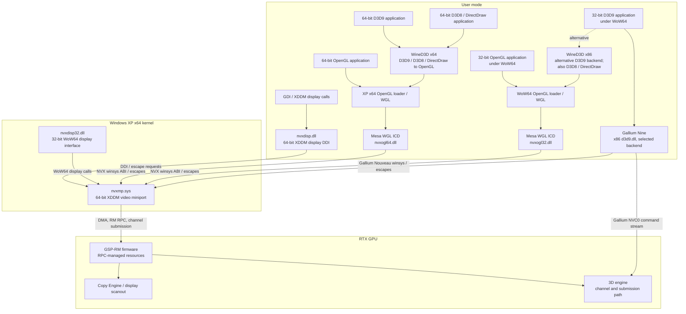
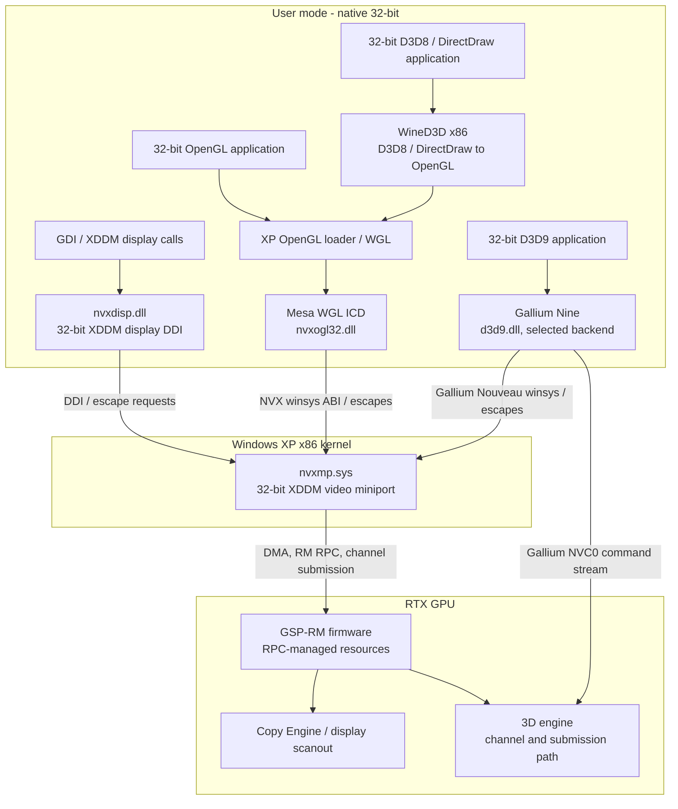
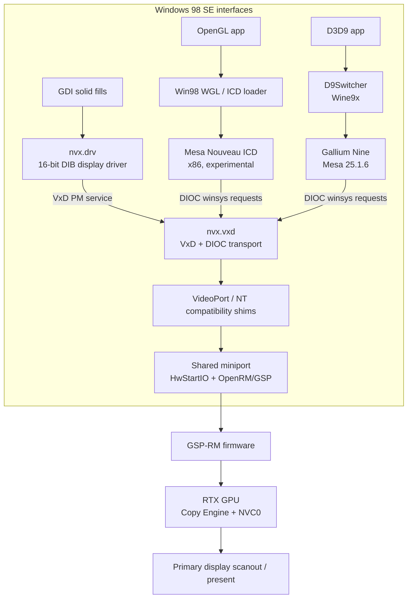

# OPEN_NVX_WINDOWS: NVIDIA RTX 3060/70 GPU Display Drivers for Windows 2000/XP (x86 & x64) & Windows 98SE/ME

This project develops display drivers for modern NVIDIA GPUs on legacy Windows. The XP miniport uses code and policy adapted from NVIDIA’s Open GPU Kernel Modules (`open-gpu-kernel-modules`) and boots NVIDIA GSP-RM firmware.
Hardware support is for GA104 (Nvidia GeForce RTX 3070, 3060 series).
Full 2D and 3D (for XP) acceleration is present. OpenGL hardware rendering works through Mesa/Nouveau. The x86 Gallium Nine D3D9 (DirectX 9) path has been validated and has rendered 3DMark05 under XP x64 WoW64 and native XP x86; the latest score is 5,409 (comparable to GeForce 6800 GT). Better acceleration and broader compatibility remain further work.

### Operating System Support
* **Windows XP Professional x64 Edition (NT 5.2):** Main development and hardware-validation target; tested with an RTX 3070, including VFIO passthrough and bare-metal.
* **Windows XP Professional x86 (NT 5.1):** Separate 32-bit build; tested in a VFIO guest. Feature coverage differs from x64.
* **Windows 98 Second Edition (SE, 4.10):** Experimental single-monitor VxD/DIB and x86 Mesa/Nouveau paths tested in a VFIO guest. Pre-release driver version 4.0.0.45; the 3D pipeline is work in progress, slow, and not reliable for general applications.
* **Windows ME / Windows 2000 / Vista / Windows 7:** Not validated but supported via compatibility modes.

### Hardware Validation & GPU Scope
* **Host Platform:** AMD AM5 (Ryzen 9000 series, IOMMU / VFIO passthrough)
* **Validated GPU:** NVIDIA GeForce RTX 3070, GA104, PCI device ID `10DE:2488`.
* **Tested Displays:** Dual-monitor setup (1x 2560×1440 @ 32bpp True Color + 1x 1920×1080 @ 32bpp True Color)
* **Code target devices:** GeForce RTX 3070, RTX 3070 Laptop GPU, RTX 3070 Ti Laptop GPU, RTX 3060 Ti, RTX 3060, and RTX 3060 GA104.

---

## Architectural Comparison

| Feature | Windows XP (x86) | Windows XP (x64) | Windows 98 SE |
| :--- | :--- | :--- | :--- |
| **Driver Architecture** | Windows 2000/XP Display Driver Model (XDDM 32-bit) | Windows XP Display Driver Model (XDDM 64-bit) | Hybrid Ring 0 VxD + 16-bit GDI Display Driver |
| **Kernel Component** | `nvxmp.sys` (32-bit video miniport driver, built as `nvxmp32.sys`) | `nvxmp.sys` (64-bit video miniport driver) | `nvx.vxd` (32-bit LE Virtual Device Driver) |
| **Display Component** | `nvxdisp.dll` (32-bit GDI display driver, built as `nvxdisp32.dll`) | `nvxdisp.dll` (64-bit GDI display driver) | `nvx.drv` (Head 0); optional `nvx2.drv` Head 1 build |
| **2D Acceleration Engine** | Full Hardware Acceleration (Ampere Copy Engine) | Full Hardware Acceleration (Ampere Copy Engine) | GPU-backed 32bpp GDI solid fills via VxD/OpenRM; CPU fallback for other operations |
| **3D Acceleration Engine** | Mesa WGL/Nouveau for OpenGL; Gallium Nine for D3D9 (latest user-reported 3DMark05 score: 5,409) | Mesa WGL/Nouveau for OpenGL; x86 Gallium Nine for D3D9; WineD3D for other D3D paths | Experimental x86 Mesa/Nouveau OpenGL; bounded Nine D3D9 triangle and GPU submissions observed. 3DMark03 currently renders incorrectly/black; general app coverage is unproven |
| **Hardware Bootstrap** | Authentic GSP-RM firmware booted via Falcon/SEC2 | Authentic GSP-RM firmware booted via Falcon/SEC2 | Authentic GSP-RM firmware booted via Falcon/SEC2 |
| **Multi-Monitor Method** | Windows XP XDDM multi-head scanout surfaces / DualView | Windows XP XDDM multi-head scanout surfaces / DualView | Win98 single-monitor package; native EVO reports both heads active, GDI dual-view partially validated |
| **Tested Resolutions** | 2560×1440 + 2560×1440 @ 32bpp True Color | 2560×1440 + 2560×1440 @ 32bpp True Color | 2560×1440 @ 32bpp primary; GSP/EVO modeset and matching 10,240-byte pitch boot-tested |

---
## Architecture

The diagrams show the implemented data flow and current boundaries. XP x64 is the primary target; its diagram includes both native x64 applications and 32-bit applications running under WoW64. Native XP x86 is a separate build. OpenGL uses Mesa/Nouveau; x86 D3D9 can use Gallium Nine, while WineD3D supplies the compatibility paths. Hardware validation is focused on an RTX 3070 (GA104, `10DE:2488`); successful rendering does not imply broad API coverage or mature performance.

### Windows XP x64



The miniport owns device setup, memory mappings, RM/GSP communication, display modes, and the user/kernel submission ABI. The x64 and WoW64 display interfaces both reach the same x64 miniport. Mesa's WGL ICD and Nouveau winsys use that ABI for OpenGL. The selected x86 Gallium Nine `d3d9.dll` submits through Gallium/Nouveau; x86 WineD3D is an alternative D3D9 backend and supplies D3D8/DirectDraw. x64 D3D applications use WineD3D. On XP x64, all 32-bit user-mode DLLs shown here install in `SysWOW64`. Build and install the intended x86 D3D9 backend explicitly because both backends provide `d3d9.dll`.

### Windows XP x86 (native 32-bit)

This section describes only a native 32-bit Windows XP installation. It does not describe 32-bit applications running under WoW64 on XP x64.



The x86 diagram is the same graphics route without WoW64: every application and user-mode DLL is 32-bit, and the kernel miniport is also 32-bit. The build outputs `nvxmp32.sys` and `nvxdisp32.dll` are staged under the standard package names `nvxmp.sys` and `nvxdisp.dll`; all user-mode graphics DLLs install under `Windows\\System32`. Gallium Nine supplies D3D9; WineD3D supplies D3D8 and DirectDraw. The latest user-reported 3DMark05 run on this path scored 5,409.

### Windows 98 SE (experimental, single monitor)



Eligible 32bpp GDI solid fills go through `nvx.drv`, the VxD transport, and shared OpenRM/GSP submission; other 2D operations use CPU fallback. `DibEngine=0` is required for the driver's BitBlt callback. Experimental Mesa OpenGL and Gallium Nine D3D9 paths also reach the miniport through DIOC shims. OpenGL cube/gears and a bounded Nine triangle have rendered in earlier runs. In the current 3DMark03 run, Nine initializes and submits NVC0 draws, but the visible output is flashing/black and GART backing allocations fail under load. This is not reliable general 3D support. QHD modesetting has been exercised; the package target remains one monitor. See [src_win98/README.md](src_win98/README.md) for details.

---

## Build Instructions

### Debian 12 host prerequisites

These commands assume a Debian 12 (Bookworm) amd64 host and a checkout with its source submodules initialized. Install the base tools and both MinGW targets for XP x64/x86 driver builds:

```sh
sudo apt update
sudo apt install build-essential git python3 \
  gcc-mingw-w64-x86-64 g++-mingw-w64-x86-64 \
  gcc-mingw-w64-i686 g++-mingw-w64-i686 \
  binutils-mingw-w64 genisoimage perl
git submodule update --init --recursive
```

The XP miniport embeds `dist_full/gsp_ga104.bin`; this firmware file must already be present. The miniport build does not build the OpenGL ICD or DirectX translation layer; build both before packaging graphics support.

For the Mesa WGL ICD, install the additional cross-build tools:

```sh
sudo apt install gcc-mingw-w64-x86-64-posix g++-mingw-w64-x86-64-posix \
  gcc-mingw-w64-i686-posix g++-mingw-w64-i686-posix \
  ninja-build python3-venv python3-pip python3-ply pkg-config bison flex \
  libelf-dev libzstd-dev libexpat1-dev zlib1g-dev
python3 -m venv /tmp/nvx-meson-venv
/tmp/nvx-meson-venv/bin/pip install 'meson>=1.3' mako pyyaml
```

VFIO/QEMU integration tests and offline guest-image updates additionally need host tools such as `qemu-system-x86`, `qemu-utils`, `libguestfs-tools`, `guestmount`, `libhivex-bin` (for `hivexregedit`), and `genisoimage`. They are not required for cross-compilation. VFIO also requires host IOMMU/VFIO configuration and access to the target GPU; see [test/README.md](test/README.md).

The Windows 98 16-bit display driver additionally needs Open Watcom C/C++ and JWasm; see [src_win98/README.md](src_win98/README.md).

### Build Windows XP x64 driver binaries

From the repository root:

```sh
# Build the x64 miniport with the GSP/RM path enabled.
make -C src_driver full

# Build both display-driver architectures; use target nvxdisp.dll for x64 only.
make -C src_disp all
```

Outputs are `src_driver/nvxmp.sys`, `src_disp/nvxdisp.dll`, and `src_disp/nvxdisp32.dll`. Host-side checks are separate from compilation:

```sh
make -C src_driver check
make -C src_disp check
```

To stage the x64 miniport and display DLL in the install bundle after building:

```sh
install -D -m 0644 src_driver/nvxmp.sys dist_full/nvxmp.sys
install -D -m 0644 src_disp/nvxdisp.dll dist_full/nvxdisp.dll
```

Keep the matching `dist_full/nvx.inf`, `dist_full/gsp_ga104.bin`, and `dist_full/install.bat` alongside them. The miniport embeds the firmware at build time; the firmware file is also included in the prepared install bundle.

The default miniport target is not the full hardware configuration; use `full` for the GSP build. To build the XP-compatible Mesa WGL ICD, the script applies temporary patches to the Mesa submodule, builds in `/tmp`, restores the submodule source, and copies finished DLLs to `dist_full/`:

```sh
NVX_MESA_ARCH=x64 MESON=/tmp/nvx-meson-venv/bin/meson ./test/build_mesa_xp64.sh
NVX_MESA_ARCH=x86 MESON=/tmp/nvx-meson-venv/bin/meson ./test/build_mesa_xp64.sh
```

The x64 build produces `dist_full/nvxogl64.dll` and `dist_full/nvxmesa.dll`; x86 produces `dist_full/nvxogl32.dll`. The ICD build includes Nouveau and Softpipe. A DLL's presence alone does not establish that an application selected Nouveau or completed its workload on the GPU.

### Build the DirectX-to-OpenGL layer (required for DirectX)

The project uses its pinned Wine source submodule to build XP-compatible WineD3D DLLs for both x64 and x86 applications. These provide Direct3D 9, Direct3D 8, and DirectDraw entry points and route rendering to the Mesa OpenGL ICD. Build them after installing the Debian cross-compilers above:

```sh
./test/build_wined3d_xp.sh
```

The script checks the pinned Wine revision and builds the XP-supported Direct3D 9, Direct3D 8, and DirectDraw DLLs for both architectures into `test/wined3d_xp/x64/` and `test/wined3d_xp/x86/`. Stage every runtime DLL for the full installer:

```sh
for dll in d3d9 d3d8 ddraw wined3d libwine; do
  install -D -m 0644 "test/wined3d_xp/x64/$dll.dll" "dist_full/$dll.dll"
  install -D -m 0644 "test/wined3d_xp/x86/$dll.dll" "dist_full/x86/$dll.dll"
done
```

For a full package, keep the x86 DLLs under `dist_full/x86/`; the offline updater and batch installer both use that directory for `SysWOW64`. The x64 DLLs belong at the package root and go to `Windows\System32`. Do not mix architectures. `test_full_driver.sh` builds WineD3D by default before its integration run; set `NVX_BUILD_WINED3D=0` only when deliberately reusing an already-built WineD3D package.

### Build the Gallium Nine Direct3D 9 frontend

Gallium Nine is built as an x86 `d3d9.dll` from Mesa 25.1.6 bundled in `submodules/mesa9x/mesa-25.1.x`. XP-specific changes are kept in the root repository under `patches/mesa9x/` and `mesa_patches/nine/`; the patch script applies the Mesa9x compatibility changes before building. Build Nine after WineD3D when Nine should be the selected x86 D3D9 implementation, because both produce `dist_full/x86/d3d9.dll`:

```sh
./build_d3d9_nine.sh
```

The script checks the Mesa 25.1.6 pin, applies the external Mesa9x compatibility patches and root-owned Nine shims, builds `mesa99.dll`, checks the x86 PE format and `Direct3DCreate9` exports, then stages it as `dist_full/x86/d3d9.dll`. The x86 Nine path has rendered the 3DMark05 game tests; the latest user-reported score is 5,409. Performance remains below the 10,000-point target, and CSMT is gated off when Nouveau does not advertise persistent coherent mappings. Nine does not replace x64 WineD3D or the x86 D3D8/DirectDraw DLLs. The full test runner selects Nine by default and avoids rebuilding WineD3D over its x86 `d3d9.dll`; set `NVX_D3D9_BACKEND=wined3d` to select WineD3D instead.

### Build Windows XP x86 driver binaries

```sh
make -C src_driver full32
make -C src_disp nvxdisp32.dll

# Stage with the filenames expected inside a 32-bit XP guest.
install -D src_driver/nvxmp32.sys dist32/nvxmp.sys
install -D src_disp/nvxdisp32.dll dist32/nvxdisp.dll
```

Include `dist32/nvx.inf` in the package. Build the 32-bit Mesa ICD with `NVX_MESA_ARCH=x86 ./test/build_mesa_xp64.sh` and stage `dist_full/nvxogl32.dll` in `dist32/` as shown below. Every binary in this native x86 package must be 32-bit.

Assemble the native XP x86 installer package after building the x86 Mesa ICD, WineD3D, and Gallium Nine. Build WineD3D first, then Nine so Nine remains the selected `d3d9.dll`:

```sh
install -D -m 0644 dist_full/gsp_ga104.bin dist32/gsp_ga104.bin
install -D -m 0644 dist_full/nvxogl32.dll dist32/nvxogl32.dll
install -D -m 0644 dist_full/x86/d3d9.dll dist32/d3d9.dll
for dll in d3d8 ddraw wined3d libwine; do
  install -D -m 0644 "dist_full/x86/$dll.dll" "dist32/$dll.dll"
done
install -D -m 0644 test/test_gpu_accel32.exe dist32/test_gpu_accel32.exe
install -D -m 0644 test/3d_tests/wglgears32.exe dist32/wglgears32.exe
install -D -m 0644 dist_full/x86/test_3dmark_launch_diag.exe dist32/test_3dmark_launch_diag.exe
```

The resulting `dist32/` package includes `install.bat`. Run it as Administrator inside native Windows XP x86. It rejects WoW64, backs up replaced files, installs the x86 driver, Mesa OpenGL ICD, Gallium Nine D3D9 and WineD3D D3D8/DirectDraw components, registers the ICD, and stages optional test tools.

### Build Windows 98 SE components

```sh
source src_win98/owenv.sh
./src_win98/build.sh
```

The output files, including a DOS-mode package-staging `install.bat`, are placed in `dist_win98/`. The optional Mesa ICD and Nine/Wine9x runtime bundles use separate scripts under `test/`.

## Installation & Usage

The steps below assume you are installing from a downloaded ZIP on the Windows XP machine. Download the full release ZIP for the XP edition you have, copy it to the guest, and extract it to a simple directory such as `C:\nvx_driver`. Do not install the XP x64 package on native XP x86 or vice versa. If you built the package from source, use the assembled `dist_full/` (XP x64) or `dist32/` (native XP x86) folder; `src_driver/` by itself is source code, not a complete graphics-runtime package.

The full release package includes the miniport, display driver, firmware, INF, OpenGL ICD, and DirectX runtime components. A driver-only ZIP made from miniport/display build outputs can install the display driver, but does not include Mesa OpenGL or WineD3D/Gallium Nine DirectX components; use the full package when you want 3D acceleration.

### Windows XP x64

1. Extract the XP x64 full ZIP on the guest, for example to `C:\nvx_driver`.
2. Open the extracted folder and run `install.bat` as an Administrator. The package installer backs up replaced files, copies the x64 miniport and display driver, installs the x64 and WoW64 OpenGL/DirectX components, and stages the INF and diagnostic tools.
3. Open **Device Manager** (`devmgmt.msc`). Under **Display adapters** (or **Other devices** if the card is not yet bound), select the NVIDIA adapter and choose **Update Driver** -> **Install from a list or specific location** -> **Don't search** -> **Have Disk...**. Browse to `C:\nvx_driver\nvx.inf`, select the matching NVIDIA entry, and accept the driver warning if shown.
4. Reboot Windows XP.

On XP x64, x64 user-mode DLLs install in `System32`; 32-bit WoW64 DLLs install in `SysWOW64`. The x86 `d3d9.dll` included at `x86\d3d9.dll` is the selected D3D9 backend for 32-bit apps. Gallium Nine and WineD3D both provide this filename, so the package must contain the backend you intend to use. Keep the rest of the x86 WineD3D DLLs (`d3d8.dll`, `ddraw.dll`, `wined3d.dll`, `libwine.dll`) alongside it when using Nine for D3D9.

### Windows XP x86

This applies only to a native 32-bit Windows XP installation, not 32-bit apps running under WoW64 on XP x64.

1. Extract the native XP x86 full ZIP on the guest, for example to `C:\nvx_driver`.
2. Run its `install.bat` as an Administrator. It checks that this is native x86 XP, backs up replaced files, installs the 32-bit miniport, display driver, OpenGL ICD, Gallium Nine D3D9 and WineD3D D3D8/DirectDraw components, and stages the INF and tests.
3. In **Device Manager**, use **Display adapters** (or **Other devices**) -> **Update Driver** -> **Install from a list or specific location** -> **Don't search** -> **Have Disk...** and choose `C:\nvx_driver\nvx.inf`. Select the NVIDIA entry and accept the warning if shown.
4. Reboot Windows XP.

### Driver-only ZIP

If you have only the miniport/display-driver ZIP from a `src_driver` build, extract it on XP and use Device Manager -> **Update Driver** -> **Have Disk...** with the included `nvx.inf`. That package does not install the Mesa ICD or DirectX translation DLLs, so it is suitable for binding/updating the display driver but does not by itself provide the full accelerated OpenGL/DirectX stack. For full 3D support, use the matching full release ZIP or build and assemble `dist_full/` / `dist32/` as described above.

After reboot, verify the OpenGL renderer with the included test tools. `GDI Generic` means the application fell back to software OpenGL. Successful installation does not prove that every OpenGL or Direct3D workload is supported; 3D performance and compatibility remain under development. Back up the XP installation before installing because the full package replaces system DirectX runtime DLLs.

Repository-maintainer instructions for updating the offline QEMU images are in [test/README.md](test/README.md); they are not needed for a normal installation from a release ZIP.

### Windows 98 SE

Use the single-monitor package in `dist_win98/`. To stage it from real-mode DOS, boot to **Command prompt only**, change to the extracted package directory, and run `install.bat`. It copies the package to `C:\DRIVERS\NVX` without changing the active Windows installation. Restart Windows, open Device Manager, update the display adapter, and use **Have Disk** to select `C:\DRIVERS\NVX\nvx.inf`; reboot when prompted. DOS staging does not perform the PnP/registry binding. `attach_sec.exe` is for secondary-head experiments outside the validated single-monitor setup. See [src_win98/README.md](src_win98/README.md).

---

## Repository Structure

```
├── README.md           # Project overview and build instructions
├── dist_full/           # XP x64 integration bundle: driver, firmware, ICDs, tests, and WineD3D DLLs
├── dist32/              # Native Windows XP x86 package and install.bat
├── dist_win98/          # Windows 98 SE package (driver, firmware, INF, DOS staging installer)
├── src_driver/          # Unified GA104 miniport engine, GSP/RPC/MMU/Display code, and OpenRM HAL shim
├── src_disp/            # Windows XP GDI display driver (both 64-bit and 32-bit builds)
├── src_win98/           # Windows 98 SE components:
│   ├── winvbe_drv/      # 16-bit DIB Engine display drivers (nvx.drv, nvx2.drv)
│   ├── shim/            # Ring 0 NT VideoPort to VMM translation layer
│   ├── attach_sec.c     # Win32 secondary monitor attachment utility
│   └── build_vxd.sh     # VxD compilation and packaging script
├── mesa_patches/        # XP compatibility shims and Nouveau/Softpipe winsys integration (Mesa submodule stays clean)
├── patches/mesa9x/      # External, reproducible compatibility patch series for Mesa9x
├── mesa/                # Pinned Mesa 25.1.6 source used for the WGL ICD
├── submodules/mesa9x/   # Mesa9x integration with bundled Mesa 25.1.6 and Gallium Nine
├── submodules/wine9x/   # Win9x DirectX switchers; D3D9 can route to Mesa Nine
├── wine/                # Pinned Wine source used to build XP WineD3D DLLs
├── wine_patches/        # External Wine compatibility patches used by the build script
├── test/                # Automated test infrastructure, regression runners, and QEMU/VFIO scripts
├── open-gpu-kernel-modules/ # NVIDIA OpenRM upstream repository (submodule)
├── notes/               # Project status, phase evaluation, hardware notes, and firmware provenance
│   ├── handoff.txt       # Current phase status and engineering roadmap
│   ├── SUMMARY.txt       # Cumulative hardware test history
│   ├── PHASE2C_MESA_EVALUATION.md
│   ├── nvx_nouveau_port_map.md
│   └── FIRMWARE_PROVENANCE.md
```

---

## Credits & Acknowledgments

- **NVIDIA Corporation** for Ampere GA104 GPU hardware, GSP-RM and SEC2 microcode, and the [NVIDIA Open GPU Kernel Modules](https://github.com/NVIDIA/open-gpu-kernel-modules).
- **The Linux Nouveau DRM Team** for extensive documentation and public reference implementations of GSP initialization and sequencer logic.
- **Michal Necasek & Jmh (WINVBE Project)** for the open-source 16-bit DIB Engine Windows 98 display driver framework.
- **nullmoth ([nvidia-macos-driver](https://github.com/nullmoth/nvidia-macos-driver))** for community reverse-engineering notes on modern NVIDIA GPU architectures.
- **Sanjay Seshan** for physical GPU and multi-monitor validation, reverse engineering, hardware testing, and project creation.
- **GPT and Gemini** artificial intelligence models for paired programming, kernel shim engineering, and continuous debugging assistance.
- **ReactOS** for XDDM implementation reference.

---

## License & Firmware Notice

MIT license. NVIDIA GSP-RM and SEC2 firmware components remain the intellectual property of NVIDIA Corporation and are subject to NVIDIA's licensing terms. Review [notes/FIRMWARE_PROVENANCE.md](notes/FIRMWARE_PROVENANCE.md) before redistributing.
