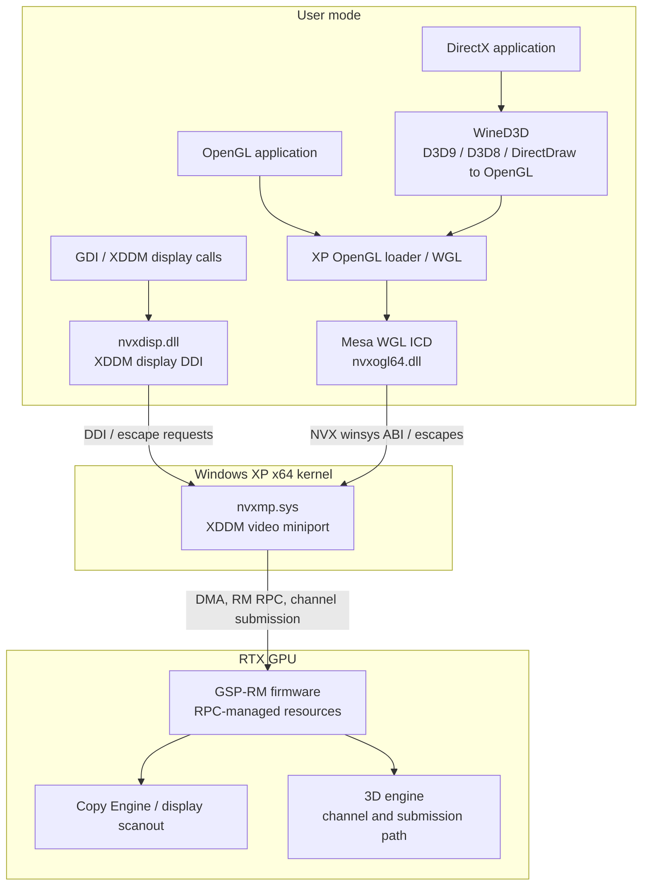
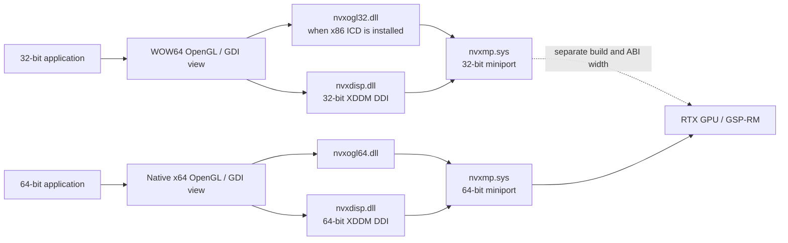
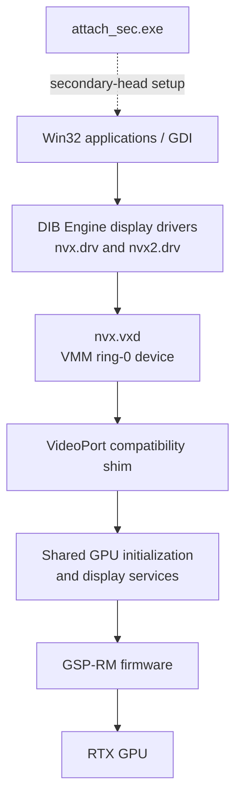

# NVIDIA Modern GPU Display Drivers for Windows 2000/XP (x86 & x64) & Windows 98SE/ME

This project develops display drivers for modern NVIDIA GPUs on legacy Windows. The XP miniport uses code and policy adapted from NVIDIA’s Open GPU Kernel Modules (`open-gpu-kernel-modules`) and boots NVIDIA GSP-RM firmware. Hardware validation is primarily on an RTX 3070 (GA104); related GPU families are not yet validated. Full 2D acceleration is present. 3D accleration works in XP x64 via Mesa/wined3d, albeit somewhat slow right now.

### Operating System Support
* **Windows XP Professional x64 Edition (NT 5.2):** Main development and hardware-validation target; tested with an RTX 3070, including VFIO passthrough.
* **Windows XP Professional x86 (NT 5.1):** Separate 32-bit build; tested in a VFIO guest. Feature coverage differs from x64.
* **Windows 98 Second Edition (SE, 4.10):** Experimental VxD/DIB path tested in a VFIO guest.
* **Windows ME / Windows 2000 / Vista / Windows 7:** Not validated. Compatibility should not be assumed.

### Hardware Validation & Target GPUs
* **Host Platform:** AMD AM5 (Ryzen 9000 series, IOMMU / VFIO passthrough)
* **Tested GPU:** NVIDIA GeForce RTX 3070 (Ampere GA104)
* **Tested Displays:** Dual-monitor setup (1x 2560×1440 @ 32bpp True Color + 1x 1920×1080 @ 32bpp True Color)
* **Potential GPU families for this firmware generation (only GA104 tested):**
  * GTX 16 series (Turing TU10x, untested)
  * RTX 20 series (Turing TU10x, untested)
  * RTX 30 series (Ampere GA10x, tested GA104)
  * RTX 40 series (Ada Lovelace AD10x, untested)

---

## Architectural Comparison

| Feature | Windows XP (x86) | Windows XP (x64) | Windows 98 SE |
| :--- | :--- | :--- | :--- |
| **Driver Architecture** | Windows 2000/XP Display Driver Model (XDDM 32-bit) | Windows XP Display Driver Model (XDDM 64-bit) | Hybrid Ring 0 VxD + 16-bit GDI Display Driver |
| **Kernel Component** | `nvxmp.sys` (32-bit video miniport driver, built as `nvxmp32.sys`) | `nvxmp.sys` (64-bit video miniport driver) | `nvx.vxd` (32-bit LE Virtual Device Driver) |
| **Display Component** | `nvxdisp.dll` (32-bit GDI display driver, built as `nvxdisp32.dll`) | `nvxdisp.dll` (64-bit GDI display driver) | `nvx.drv` (Head 0) & `nvx2.drv` (Head 1) (16-bit NE) |
| **2D Acceleration Engine** | Full Hardware Acceleration (Ampere Copy Engine) | Full Hardware Acceleration (Ampere Copy Engine) | Partial Acceleration (DIB Engine RAM shadow buffer + burst VRAM flush) |
| **3D Acceleration Engine** | Software fallback | 3D via Mesa WGL bridge & Gallium NVC0 port | Software rasterization |
| **Hardware Bootstrap** | Authentic GSP-RM firmware booted via Falcon/SEC2 | Authentic GSP-RM firmware booted via Falcon/SEC2 | Authentic GSP-RM firmware booted via Falcon/SEC2 |
| **Multi-Monitor Method** | Windows XP XDDM multi-head scanout surfaces / DualView | Windows XP XDDM multi-head scanout surfaces / DualView | Dual display drivers (`nvx.drv` + `nvx2.drv`) & desktop extension via `attach_sec.exe` |
| **Tested Resolutions** | 1920×1080 + 2560×1440 @ 32bpp True Color | 2560×1440 + 2560×1440 @ 32bpp True Color | 1920×1080 + 2560×1440 @ 32bpp True Color |

---
## Architecture

The diagrams show the intended data flow and the current implementation boundaries. XP x64 is the primary target. The Mesa/Nouveau OpenGL route is present but remains under active validation; driver boot and 2D operation do not imply arbitrary OpenGL or Direct3D workloads are complete.

### Windows XP x64



The miniport owns device setup, memory mappings, RM/GSP communication, display modes, and the user/kernel submission ABI. `nvxdisp.dll` provides the XP XDDM display interface. The OpenGL ICD and Nouveau winsys use that ABI; the hardware 3D path is still being validated with broader workloads. WineD3D is the project's DirectX compatibility layer: it implements the D3D9, D3D8, and DirectDraw interfaces and translates their rendering through the OpenGL ICD. It is a required part of the DirectX path, although it is built and packaged separately from the display driver.

### Windows XP x86 (and WOW64)



On XP x64, x86 and x64 DLLs belong in separate system directories and OpenGL registry views. The x86 build is a separate target; do not infer x86 OpenGL support from the x64 package. Build outputs use `nvxmp32.sys` and `nvxdisp32.dll` names before staging as `nvxmp.sys` and `nvxdisp.dll` for an x86 guest.

### Windows 98 SE (experimental)



This path uses the DIB engine and a RAM shadow/flush strategy for desktop drawing; it is not the XP OpenGL ICD path. See [src_win98/README.md](src_win98/README.md) for design and setup details.

---

## Build Instructions

### Debian 12 host prerequisites

These commands assume a Debian 12 (Bookworm) amd64 host and a checkout with its source submodules initialized. Install the base tools and both MinGW targets for XP x64/x86 driver builds:

```sh
sudo apt update
sudo apt install build-essential git python3 \
  gcc-mingw-w64-x86-64 g++-mingw-w64-x86-64 \
  gcc-mingw-w64-i686 g++-mingw-w64-i686 \
  binutils-mingw-w64 genisoimage perl
git submodule update --init --recursive
```

The XP miniport embeds `dist_full/gsp_ga104.bin`; this firmware file must already be present. The miniport build does not build the OpenGL ICD or DirectX translation layer; build both before packaging graphics support.

For the Mesa WGL ICD, install the additional cross-build tools:

```sh
sudo apt install gcc-mingw-w64-x86-64-posix g++-mingw-w64-x86-64-posix \
  gcc-mingw-w64-i686-posix g++-mingw-w64-i686-posix \
  ninja-build python3-venv python3-pip python3-ply pkg-config bison flex \
  libelf-dev libzstd-dev libexpat1-dev zlib1g-dev
python3 -m venv /tmp/nvx-meson-venv
/tmp/nvx-meson-venv/bin/pip install 'meson>=1.3' mako pyyaml
```

VFIO/QEMU integration tests and offline guest-image updates additionally need host tools such as `qemu-system-x86`, `qemu-utils`, `libguestfs-tools`, `guestmount`, `libhivex-bin` (for `hivexregedit`), and `genisoimage`. They are not required for cross-compilation. VFIO also requires host IOMMU/VFIO configuration and access to the target GPU; see [test/README.md](test/README.md).

The Windows 98 16-bit display driver additionally needs Open Watcom C/C++ and JWasm; see [src_win98/README.md](src_win98/README.md).

### Build Windows XP x64 driver binaries

From the repository root:

```sh
# Build the x64 miniport with the GSP/RM path enabled.
make -C src_driver full

# Build both display-driver architectures; use target nvxdisp.dll for x64 only.
make -C src_disp all
```

Outputs are `src_driver/nvxmp.sys`, `src_disp/nvxdisp.dll`, and `src_disp/nvxdisp32.dll`. Host-side checks are separate from compilation:

```sh
make -C src_driver check
make -C src_disp check
```

To stage the x64 miniport and display DLL in the install bundle after building:

```sh
install -D -m 0644 src_driver/nvxmp.sys dist_full/nvxmp.sys
install -D -m 0644 src_disp/nvxdisp.dll dist_full/nvxdisp.dll
```

Keep the matching `dist_full/nvx.inf`, `dist_full/gsp_ga104.bin`, and `dist_full/install.bat` alongside them. The miniport embeds the firmware at build time; the firmware file is also included in the prepared install bundle.

The default miniport target is not the full hardware configuration; use `full` for the GSP build. To build the XP-compatible Mesa WGL ICD, the script applies temporary patches to the Mesa submodule, builds in `/tmp`, restores the submodule source, and copies finished DLLs to `dist_full/`:

```sh
NVX_MESA_ARCH=x64 MESON=/tmp/nvx-meson-venv/bin/meson ./test/build_mesa_xp64.sh
NVX_MESA_ARCH=x86 MESON=/tmp/nvx-meson-venv/bin/meson ./test/build_mesa_xp64.sh
```

The x64 build produces `dist_full/nvxogl64.dll` and `dist_full/nvxmesa.dll`; x86 produces `dist_full/nvxogl32.dll`. The ICD build includes Nouveau and Softpipe. A DLL's presence alone does not establish that an application selected Nouveau or completed its workload on the GPU.

### Build the DirectX-to-OpenGL layer (required for DirectX)

The project uses its pinned Wine source submodule to build XP-compatible WineD3D DLLs for both x64 and x86 applications. These provide Direct3D 9, Direct3D 8, and DirectDraw entry points and route rendering to the Mesa OpenGL ICD. Build them after installing the Debian cross-compilers above:

```sh
./test/build_wined3d_xp.sh
```

The script checks the pinned Wine revision and builds the XP-supported Direct3D 9, Direct3D 8, and DirectDraw DLLs for both architectures into `test/wined3d_xp/x64/` and `test/wined3d_xp/x86/`. Stage every runtime DLL for the full installer:

```sh
for dll in d3d9 d3d8 ddraw wined3d libwine; do
  install -D -m 0644 "test/wined3d_xp/x64/$dll.dll" "dist_full/$dll.dll"
  install -D -m 0644 "test/wined3d_xp/x86/$dll.dll" "dist_full/x86/$dll.dll"
done
```

For a full package, keep the x86 DLLs under `dist_full/x86/`; the offline updater and batch installer both use that directory for `SysWOW64`. The x64 DLLs belong at the package root and go to `Windows\System32`. Do not mix architectures. `test_full_driver.sh` builds WineD3D by default before its integration run; set `NVX_BUILD_WINED3D=0` only when deliberately reusing an already-built WineD3D package.

### Build Windows XP x86 driver binaries

```sh
make -C src_driver full32
make -C src_disp nvxdisp32.dll

# Stage with the filenames expected inside a 32-bit XP guest.
install -D src_driver/nvxmp32.sys dist32/nvxmp.sys
install -D src_disp/nvxdisp32.dll dist32/nvxdisp.dll
```

Include `dist32/nvx.inf` in the package. The x86 Mesa ICD can be built with `NVX_MESA_ARCH=x86 ./test/build_mesa_xp64.sh`; for XP x64, it is installed in `SysWOW64` for 32-bit applications. For a native x86 guest, use the 32-bit driver and matching ICD only.

### Build Windows 98 SE components

```sh
source src_win98/owenv.sh
(cd src_win98/winvbe_drv && ./build.sh)
(cd src_win98 && ./build_vxd.sh)
i686-w64-mingw32-gcc -O2 -s -o dist_win98/attach_sec.exe \
  src_win98/attach_sec.c -luser32
```

The output files are placed in `dist_win98/`.

## Installation & Usage

### Windows XP x64

`dist_full/` is the full integration bundle. For OpenGL and DirectX support it must contain `nvxmp.sys`, `nvxdisp.dll`, `gsp_ga104.bin`, `nvxmesa.dll`, `nvxogl64.dll`, `nvxogl32.dll`, the five x64 WineD3D DLLs (`d3d9.dll`, `d3d8.dll`, `ddraw.dll`, `wined3d.dll`, `libwine.dll`) at its root, the matching five x86 DLLs under `x86/`, and `nvx.inf`. Test programs can also be included. Native x64 DLLs go in `System32`; x86 DLLs for WOW64 applications go in `SysWOW64`.

For the repository's prepared XP x64 guest image, shut the VM down and run the rootless offline updater:

```sh
./test/update_disk_driver_user.sh full
```

This updates `winxp_x64.qcow2`, installs the miniport, display DDI, firmware and INF, both Mesa ICDs, the Mesa test frontend, and the x64/x86 WineD3D DLL sets into their system directories, updates OpenGL registry entries, and stages available test binaries. Build both Mesa ICDs and both WineD3D architectures first; the updater rejects an incomplete `full` bundle. It requires working libguestfs/guestmount support. For a mounted physical XP partition, the mounted-volume updater only rebuilds and copies the x64 miniport and display DLL; it does not install the OpenGL or DirectX runtimes:

```sh
XP_MOUNT=/mnt/xp ./test/update_xp_driver.sh
```

For a complete manual installation in XP x64, place the full package in one directory, including all five DLLs in `x86/`, and run `install.bat` as Administrator. It checks that the miniport, display DDI, firmware, Mesa frontends, both OpenGL ICDs, and both WineD3D architectures are present before copying. It backs up replaced system DLLs, installs the x64 runtime set into `System32` and the x86 set into `SysWOW64`, stages the package and included tests under `C:\nvx_driver` and `C:\test_accel`, registers both OpenGL ICDs, and runs the INF/PnP setup. Reboot after it completes. For a driver-only installation, use Device Manager -> **Display Adapters** -> **Update Driver** -> **Have Disk...** and select `nvx.inf`; that path alone does not install OpenGL or DirectX support. Back up the guest before installing because WineD3D replaces the system D3D runtime DLLs.

After reboot, verify the renderer using the included test tools and logs. `GDI Generic` means the application fell back to software OpenGL. Successful installation does not prove that all OpenGL or Direct3D workloads are supported; 3D performance/correctness remains under active validation.

### Windows XP x86

Build or stage `dist32/nvxmp.sys` and `dist32/nvxdisp.dll` as described above and include `dist32/nvx.inf`. In XP x86, open Device Manager -> **Display Adapters** -> **Update Driver** -> **Have Disk...**, select the INF, and reboot. An x64 ICD cannot be loaded by an x86 process; install the matching `nvxogl32.dll` if using OpenGL. To deploy the driver and test binaries to the repository's offline `winxp_x32.qcow2` image, shut down the VM and run:

```sh
./test/install_xp32_driver_and_tests.sh
```

### Windows 98 SE

Use `nvx.drv`, `nvx2.drv`, `nvx.vxd`, `nvx.inf`, and `attach_sec.exe` from `dist_win98/`. Follow [src_win98/README.md](src_win98/README.md) for setup. The secondary-head utility is `attach_sec.exe`. This experimental DIB/VxD path is independent of the XP Mesa ICD.

---

## Repository Structure

```
├── README.md           # Project overview and build instructions
├── dist_full/           # XP x64 integration bundle: driver, firmware, ICDs, tests, and WineD3D DLLs
├── dist32/              # Windows XP x86 release package (nvxmp.sys, nvxdisp.dll, nvx.inf)
├── dist_win98/          # Windows 98 SE release package (nvx.drv, nvx2.drv, nvx.vxd, nvx.inf, attach_sec.exe)
├── src_driver/          # Unified GA104 miniport engine, GSP/RPC/MMU/Display code, and OpenRM HAL shim
├── src_disp/            # Windows XP GDI display driver (both 64-bit and 32-bit builds)
├── src_win98/           # Windows 98 SE components:
│   ├── winvbe_drv/      # 16-bit DIB Engine display drivers (nvx.drv, nvx2.drv)
│   ├── shim/            # Ring 0 NT VideoPort to VMM translation layer
│   ├── attach_sec.c     # Win32 secondary monitor attachment utility
│   └── build_vxd.sh     # VxD compilation and packaging script
├── mesa_patches/        # XP compatibility shims and Nouveau/Softpipe winsys integration (Mesa submodule stays clean)
├── test/                # Automated test infrastructure, regression runners, and QEMU/VFIO scripts
├── open-gpu-kernel-modules/ # NVIDIA OpenRM upstream repository (submodule)
├── notes/               # Project status, phase evaluation, hardware notes, and firmware provenance
│   ├── handoff.txt       # Current phase status and engineering roadmap
│   ├── SUMMARY.txt       # Cumulative hardware test history
│   ├── PHASE2C_MESA_EVALUATION.md
│   ├── nvx_nouveau_port_map.md
│   └── FIRMWARE_PROVENANCE.md
```

---

## Credits & Acknowledgments

- **NVIDIA Corporation** for Ampere GA104 GPU hardware, GSP-RM and SEC2 microcode, and the [NVIDIA Open GPU Kernel Modules](https://github.com/NVIDIA/open-gpu-kernel-modules).
- **The Linux Nouveau DRM Team** for extensive documentation and public reference implementations of GSP initialization and sequencer logic.
- **Michal Necasek & Jmh (WINVBE Project)** for the open-source 16-bit DIB Engine Windows 98 display driver framework.
- **nullmoth ([nvidia-macos-driver](https://github.com/nullmoth/nvidia-macos-driver))** for community reverse-engineering notes on modern NVIDIA GPU architectures.
- **Sanjay Seshan** for physical GPU and multi-monitor validation, reverse engineering, hardware testing, and project creation.
- **GPT and Gemini** artificial intelligence models for paired programming, kernel shim engineering, and continuous debugging assistance.
- **ReactOS** for XDDM implementation reference.

---

## License & Firmware Notice

MIT license. NVIDIA GSP-RM and SEC2 firmware components remain the intellectual property of NVIDIA Corporation and are subject to NVIDIA's licensing terms. Review [notes/FIRMWARE_PROVENANCE.md](notes/FIRMWARE_PROVENANCE.md) before redistributing.
